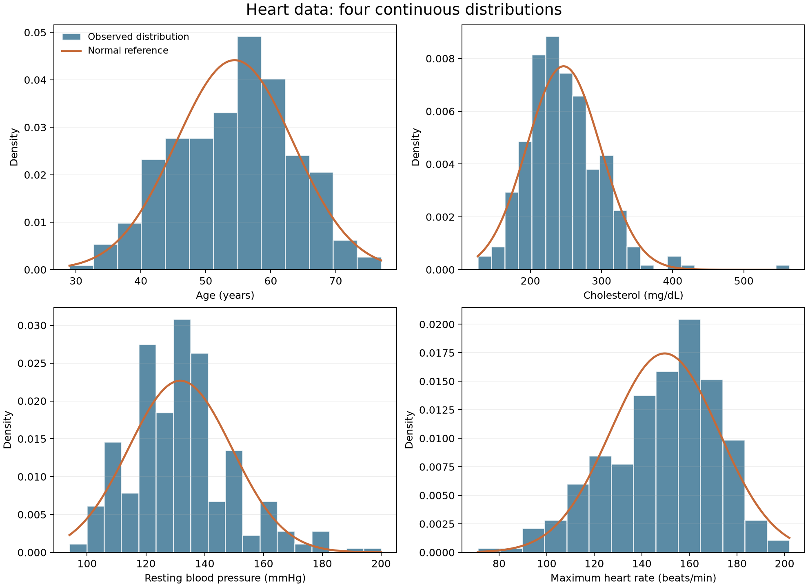
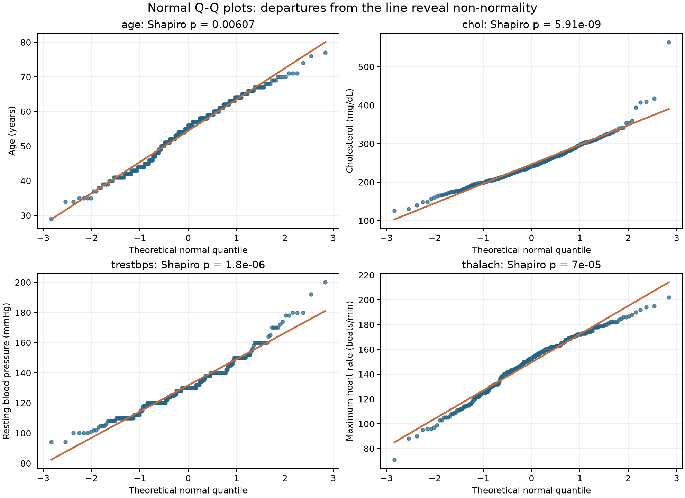
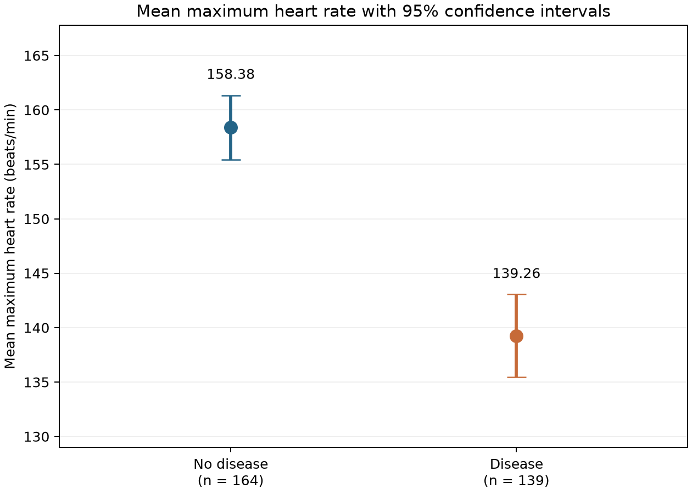
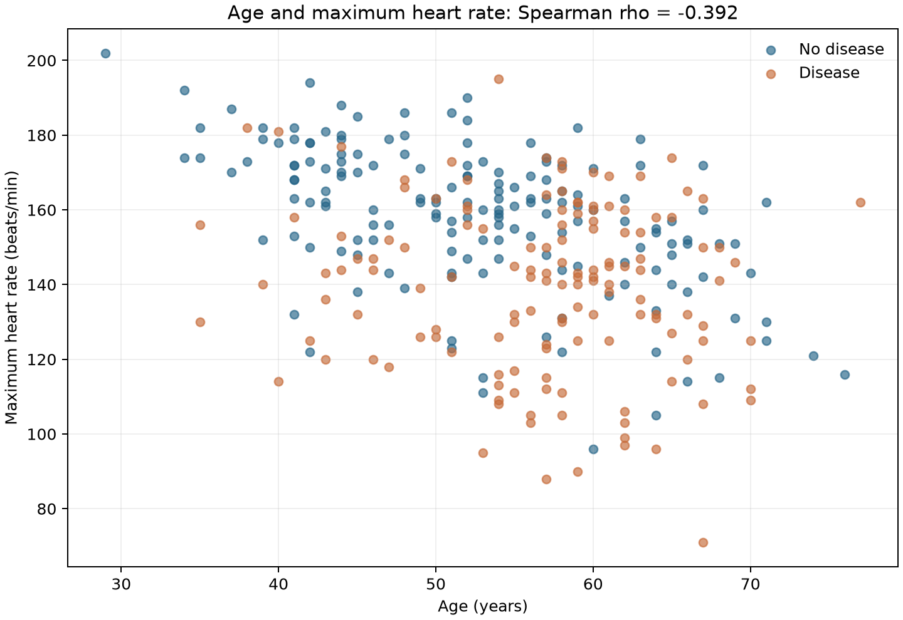
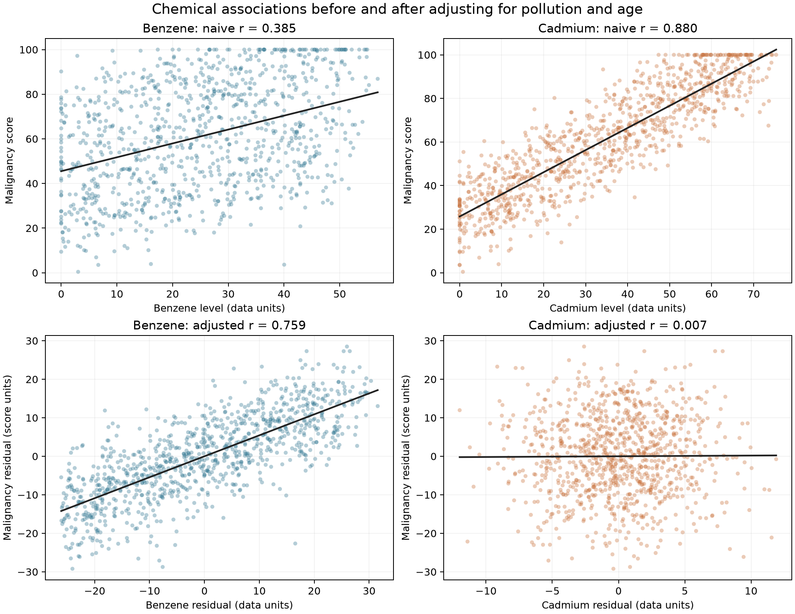
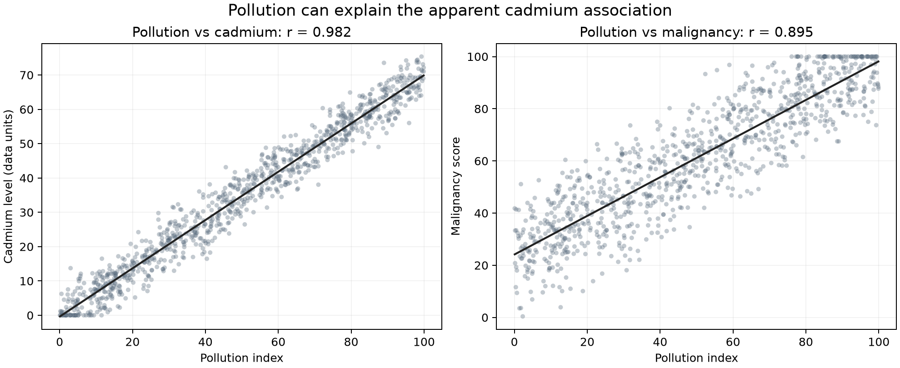

# CSPC - Computer Science for Physics and Chemistry
My coursework repository. Each practical is under `PW<n>/Lab <X>/`.

## Setup
Create the environment for a given lab:
```bash
conda env create -f PW<n>/Lab\ <X>/environment.yml
conda activate cspc
```
## PW1 - Lab A: Reproducible Foundations
What I built:
Coursework repository structure, Conda environment, Git branching, unit tests, and performance benchmark.

Speed comparison (loop vs NumPy):

loop: 5.9297 s

numpy: 0.0003 s

speed-up: 17334.6 x faster

Tests: all passing? Yes

Conclusion:
In this lab, I set up a reproducible environment using Conda and Git. The vectorised NumPy implementation demonstrated significant performance improvements over pure Python loops. All unit tests passed successfully.

## PW1 - Lab B: Data, Plotting, and Automation

- **Data Findings & Model Fit**: The observed radioactive decay data decreases exponentially over time. When plotted alongside the theoretical curve ($N_0 e^{-\lambda t}$ with $\lambda = 0.3$), the measured data closely follows the analytical decay law.
- **Snakemake Automation**: The Snakemake pipeline automates figure generation, re-running `plot.py` to produce `figure.png` only when the input files (`decay_observed.csv`, `plot.py`) are modified or when the target figure is missing.
## PW2 - Lab A: Motion from Tracking Data

- **Mean Acceleration:** -8.58 m/s²
- **Standard Deviation of Acceleration:** 28.72 m/s²
- **Max Difference (Original vs Recovered Position):** 0.78 m

### Observations:
- **Noise in Acceleration:** Numerical differentiation magnifies high-frequency measurement noise because finite differences divide small position fluctuations by the small time step ($\Delta t = 0.1\text{ s}$). Differentiating twice amplifies this effect exponentially, leading to large oscillations in acceleration even though the position data appears smooth.
- **Integration Effect:** Integration performs cumulative summation, which acts as a low-pass filter and allows zero-mean random noise to cancel out. Consequently, integrating the noisy acceleration back recovers the original position trajectory within less than a metre of error.

### Bonus (2D Trajectory):
- Processed 2D position tracking data from `trajectory.csv`.
- Computed velocity components $v_x$ and $v_y$ using numerical differentiation, then calculated total speed $\sqrt{v_x^2 + v_y^2}$.
- Generated and saved `trajectory.png` showing the 2D path and speed evolution over time.

## PW2 - Lab B: Optimization in Chemistry

Completed scripts, input data, plots, and recorded console output are in
[`PW2/Lab B/`](PW2/Lab%20B/).

### Running the scripts

From the repository root, with NumPy, SciPy, and Matplotlib installed:

```bash
conda activate cspc
python "PW2/Lab B/warmup.py"
python "PW2/Lab B/kinetics.py"
python "PW2/Lab B/equilibrium.py"
python "PW2/Lab B/titration.py"
```

The chemistry scripts read their CSVs and save their PNGs in the script's own
folder, so they also work when launched from another directory. Recorded output
is available in [`results.txt`](PW2/Lab%20B/results.txt).

### Part 2: comparing three optimization methods

For the convex function `f(x) = (x - 3)^2 + 1`, gradient descent, Newton's method,
and SLSQP all converge from `x0 = 0` to `x = 3`, where `f(x) = 1`.
The curvature is positive (`f''(x) = 2`), confirming a minimum.

For `g(x) = x^4 - 3x^2 + x + 5`, the results are:

| Start x0 | Method | Final x | g(x) | Classification |
| ---: | --- | ---: | ---: | --- |
| 0 | Gradient descent | -1.300840 | 1.486095 | Global minimum |
| 0 | Newton | 0.169938 | 5.084135 | Local maximum |
| 0 | SLSQP | -1.300840 | 1.486095 | Global minimum |
| 2 | Gradient descent | 1.130901 | 3.929770 | Local minimum |
| 2 | Newton | 1.130901 | 3.929770 | Local minimum |
| 2 | SLSQP | -1.300840 | 1.486095 | Global minimum |

Newton is applied to `g'(x) = 0`, so it finds a stationary point rather than
necessarily a minimum. From zero it reaches a point with
`g''(0.169938) = -5.653451`, identifying a maximum. From two it reaches
`g''(1.130901) = 9.347248`, identifying a minimum.

The starting point changes the result for gradient descent and Newton. SLSQP
reaches the negative minimum from both starting points in this run; its line
search can take steps across to the other minimum. This is an observed result,
not a guarantee that SLSQP always finds a global minimum. Comparing the two
minima shows that the negative one has the lower value. Since the quartic tends
to positive infinity at both ends and has no other stationary points, it is the
global minimum.

Gradient descent uses a learning rate of `0.05` and stops when the change in x
is below `1e-10`, with a limit of 10,000 iterations. Newton uses a tolerance of
`1e-12`; SLSQP uses `ftol = 1e-12`. These settings and the chosen starting points
explain the reported numerical behavior.

### Part 3: first-order reaction kinetics

The model is `C(t) = C0 * exp(-k*t)`, with the initial concentration fixed to the
first measurement, `C0 = 104.082`. Minimizing the sum of squared concentration
residuals with SLSQP, starting at `k = 0.5` and using bounds `0 <= k <= 5`, gives:

- **Fitted rate constant:** `k = 0.26176039` per data time unit.
- **Sum of squared errors:** `266.129419`.
- **Root-mean-square error:** `2.579387` concentration data units, across 40 measurements.

This is close to the expected rate constant of 0.25. The fitted curve follows the
observed exponential decay; residual scatter reflects the noisy measurements.
The CSV does not specify physical time or concentration units, so the plot uses
data units. The negative late-time observations are retained when fitting.


### Part 4: chemical equilibrium

For `H2 + I2 <=> 2 HI`, starting with 1 mol of each reactant and `K = 15.6`,
the equilibrium equation is `(2*x)^2 / (1-x)^2 - 15.6 = 0`.

| Method | Equilibrium extent x (mol) |
| --- | ---: |
| `scipy.optimize.newton` root finder | 0.663847667 |
| SLSQP, minimizing squared imbalance | 0.663847659 |

Both methods start from `x = 0.5`; SLSQP uses bounds `[0, 0.999]` to avoid
division by zero at `x = 1`. The extents agree within `8e-9` mol. The call to
`newton` does not supply a derivative, so SciPy uses its secant variant here.

Using the root-finder result, the equilibrium composition is:

| Species | Amount (mol) |
| --- | ---: |
| H2 | 0.336152 |
| I2 | 0.336152 |
| HI | 1.327695 |

The analytical solution `x = sqrt(K) / (2 + sqrt(K)) = 0.663847666961` independently
confirms the numerical result. Substitution gives the specified equilibrium
constant, and `2*n(H2) + n(HI) = 2` and `2*n(I2) + n(HI) = 2` preserve the
initial amounts of hydrogen and iodine atoms. The reactant curves coincide
because their initial amounts and stoichiometric coefficients are equal.


### Part 5: titration equivalence point (bonus)

The numerical slope is computed with `np.gradient(pH, V)`. Its maximum occurs at
**50.00 mL**, where **pH = 7.000** and the numerical slope is **4.000 pH/mL**.
This identifies the equivalence point at the steepest part of the measured pH
curve. It is an estimate on the supplied 1 mL sampling grid.


### Validation

All four scripts ran successfully using Python 3.11.9, NumPy 2.4.6,
SciPy 1.17.1, and Matplotlib 3.11.2. The warm-up solutions were checked against
the roots of the analytical derivative; the kinetic fit was checked with an
independent root solve of the error derivative; the equilibrium was checked
against the exact solution and atom conservation; and the titration result was
checked using central differences. All three saved plots were visually reviewed.

## PW3: Data, Distributions, Testing, and Causation

The completed analysis is in [`PW3/`](PW3/). Run it from the repository root:

```bash
conda activate cspc
python -m pip install -r PW3/requirements.txt
python PW3/heart_analysis.py
python PW3/chemicals_analysis.py
```

The scripts include task comments, save plots next to their input data,
and write complete numeric results to `heart_results.txt` and
`chemical_results.txt`, with matching JSON files for reproducibility.

### Data and preparation

The heart data comes from the requested
[Ritwik_B3 Kaggle dataset](https://www.kaggle.com/datasets/ritwikb3/heart-disease-cleveland),
derived from the [UCI Heart Disease dataset](https://doi.org/10.24432/C52P4X)
(Janosi, Steinbrunn, Pfisterer, and Detrano, 1989).
The downloaded `Heart_disease_cleveland_new.csv` was saved as `heart.csv`
without changing its contents. It contains **303 patients and 14 columns**:
**164 without disease** (`target = 0`) and **139 with disease** (`target = 1`).
The four continuous variables used here and every disease label were checked
against the original UCI Cleveland data; all agree, with `target = (num > 0)`.
See [`SOURCES.md`](PW3/SOURCES.md) for provenance, attribution, and the data checksum.

The supplied synthetic chemical dataset has **1,000 rows and 5 columns**.
Neither input has missing values or exact duplicate rows in its supplied form.
No observations were removed, imputed, or winsorized. This preserves unusual
but recorded values, including the high cholesterol observation.

### Session 1: distributions and normality

Histograms show each variable's shape, and normal Q-Q plots compare its ordered
values with a normal reference. Shapiro-Wilk tests provide a numerical check.
The p-values below are unadjusted descriptive diagnostics; a small p-value
indicates evidence against exact normality, not the size of the departure.

| Variable | Sample skewness | Shapiro-Wilk p | Shape and normality verdict |
| --- | ---: | ---: | --- |
| Age | -0.209 | 0.00607 | Broadly bell-shaped with mild asymmetry and tail departures; closest to normal in appearance, but exact normality is rejected. A normal approximation is only rough. |
| Cholesterol | 1.135 | 5.91e-9 | Right-skewed, with a long high-value tail and an extreme observation; not approximately normal over its full range. |
| Resting blood pressure | 0.706 | 1.80e-6 | Right-skewed, with a high-pressure tail and repeated rounded measurements; not approximately normal. |
| Maximum heart rate | -0.537 | 7.00e-5 | Left-skewed, with a longer low-heart-rate tail; not approximately normal over its full range. |

All four tests reject exact normality at the 5% level. The visual checks matter
because normality is an approximation and a test verdict alone does not decide
whether a later statistical method is appropriate.





### Session 2, Task 4: maximum heart rate by disease status

I compared the group means using a **two-sided Welch t-test**, which allows
unequal group variances. The target is the mean maximum heart rate. Although
the pooled variable is non-normal, the groups are large (139 and 164 patients),
so inference for their means is reasonably robust to the observed skewness.
This assumes independent patients. Separate group checks give Shapiro p =
0.000543 for the no-disease group and p = 0.352 for the disease group; failure
to reject in the latter group is not proof of normality.

| Group | n | Mean maximum heart rate (beats/min) | Standard error | 95% confidence interval for mean |
| --- | ---: | ---: | ---: | --- |
| No disease (`target = 0`) | 164 | 158.378 | 1.499 | [155.418, 161.338] |
| Disease (`target = 1`) | 139 | 139.259 | 1.916 | [135.470, 143.048] |

Each mean interval uses `mean +/- t(0.975, n-1) * SD/sqrt(n)`. These intervals
describe precision of the estimated mean, not the range of individual patients.

Welch's test gives **t = -7.85794**, **df = 272.2685**, and
**p = 9.11e-14**. The mean difference, **disease minus no disease**, is
**-19.119 beats/min**, with **95% CI [-23.909, -14.329]**.
There is strong evidence of a lower average maximum heart rate in the disease
group in this sample. The difference interval excludes zero, agreeing with
the clearly separated group means and their uncertainty bars.

As a check less dependent on distributional shape, the two-sided
**Mann-Whitney test** gives **U = 5806.5**, **p = 1.86e-13**. This supports a
difference in the group distributions. It is a rank-based sensitivity check,
not a general test that the means or medians are equal. Neither comparison
establishes that disease itself caused the heart-rate difference, because this
is observational data and other patient characteristics may differ.



### Task 5: age and maximum heart rate

Spearman rank correlation is **rho = -0.39163**, **p = 1.51e-12** (n = 303).
It measures monotonic association without requiring normal marginal
distributions. Pearson's linear correlation is similar: **r = -0.39381**,
**p = 1.11e-12**. Older patients tend to achieve lower maximum heart rates, but
the scatter is substantial and age alone does not determine a person's result.



### Task 6: the naive chemical analysis

Pearson correlations with malignancy initially suggest that cadmium is the
main culprit:

| Chemical | Naive Pearson r | Two-sided p |
| --- | ---: | ---: |
| Benzene | 0.38470 | 1.28e-36 |
| Cadmium | 0.87997 | < 1e-300 |

Cadmium has the stronger association, but this alone does not identify a cause.
Pollution is extremely strongly associated with cadmium (**r = 0.98187**) and
also strongly associated with malignancy (**r = 0.89514**), making it a plausible
confounding variable in the synthetic example.

### Task 7: accounting for pollution and age

For each chemical, I regress both its level and the malignancy score on
`pollution_index` and `age`, including an intercept. Correlating the two sets
of residuals gives a **partial correlation**: the remaining linear association
after accounting for those controls. The corresponding t-test uses
`n - 2 controls - 2 = 996` degrees of freedom.

| Chemical | Naive r | Partial r controlling pollution and age | Two-sided partial-correlation p |
| --- | ---: | ---: | ---: |
| Benzene | 0.38470 | 0.75948 | 3.47e-188 |
| Cadmium | 0.87997 | 0.00689 | 0.828 |

The pattern reverses: benzene has a strong remaining positive association,
while cadmium has essentially no remaining linear association after adjustment.

For comparison with the suggested filtering approach, restricting the data to
`40 < pollution_index < 60` leaves 199 patients. The correlations become
**benzene r = 0.70165** and **cadmium r = 0.31570**. The cadmium association is
reduced but still present: pollution still varies inside that band. Restriction
alone therefore leaves residual confounding; the partial-correlation analysis
provides a more complete linear adjustment.

I also fit a joint model:

```text
malignancy ~ benzene + cadmium + pollution_index + age
```

This accounts for both chemicals simultaneously. The fitted coefficients use
HC3 robust standard errors, which allow unequal residual variance; approximate
95% t confidence intervals use 995 residual degrees of freedom.

| Chemical | Adjusted coefficient | 95% confidence interval | p |
| --- | ---: | --- | ---: |
| Benzene | 0.54520 | [0.51620, 0.57419] | 1.71e-188 |
| Cadmium | -0.06773 | [-0.17959, 0.04413] | 0.235 |

The benzene coefficient means about 0.545 additional malignancy-score units
per unit of benzene, holding the other measured predictors fixed in this model.
The cadmium estimate is compatible with zero; its small negative point estimate
does not establish a protective effect. These joint-model coefficients and the
partial correlations answer slightly different adjustment questions, so their
numerical values and p-values need not match.

**Benzene is the intended causal chemical supported by this synthetic exercise;
cadmium is the chemical that only appeared guilty because it tracked pollution.**
The evidence is the persistence of benzene's association and disappearance of
cadmium's after adjustment. Strictly, observational associations cannot prove
which chemical causes malignancy: the generating code was not supplied, and a
causal interpretation also requires correct model assumptions and adequate
control of confounding. This conclusion concerns the constructed teaching data.





### Bonus: category uncertainty

For `target`, the proportions are **164/303 = 54.13%** without disease and
**139/303 = 45.87%** with disease. Shannon entropy is
`H = -sum(p * log2(p)) = 0.99508 bits`. This is close to the binary maximum of
1 bit, so the labels are nearly balanced. Always guessing the more common
class would be correct only 54.13% of the time; this describes class balance,
not the accuracy attainable using patient features.

### Reproducibility and checks

Both scripts use the included CSV files and regenerate all results and figures.
The mean-difference confidence interval was cross-checked with SciPy's Welch
result, partial correlations were checked through independent linear algebra,
and the disease coding was verified against UCI. Six saved figures were
visually reviewed. Numerical results are reported with practical rounding;
full precision is retained in the JSON files. Tiny probabilities may underflow
to zero in JSON and are displayed as upper bounds in the text report.

Tested with Python 3.11.9, pandas 3.1.1, NumPy 2.4.6, SciPy 1.17.1, and Matplotlib 3.11.2.
